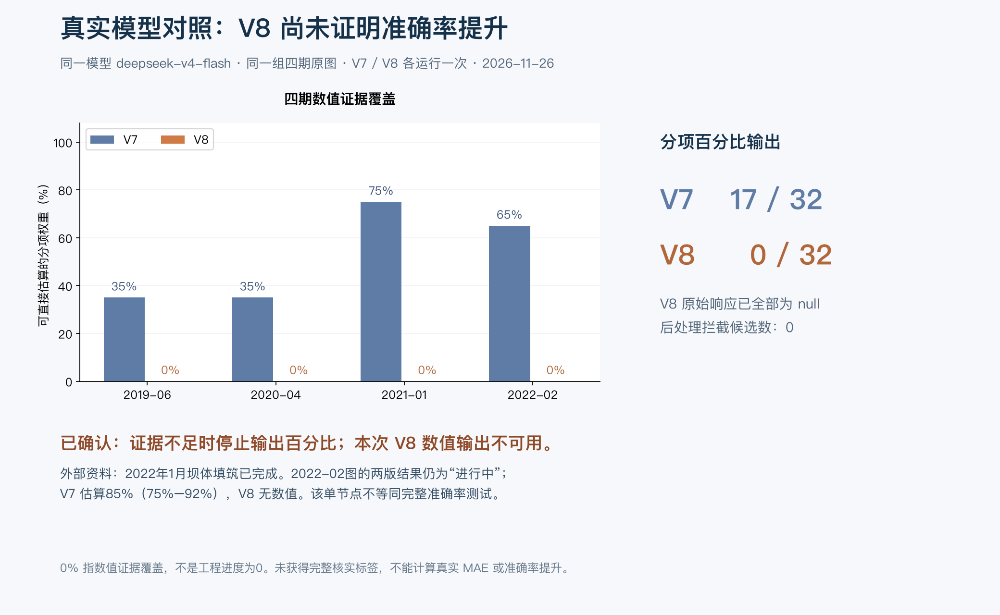

# V7 / V8 实际识别效果验证

日期：2026-11-26。结论：**本次不能认定 V8 提升了识别准确率；它在这组真实图片上没有产出任何分项百分比，数值功能可用性下降。** 前一轮测试只验证规则，本轮已执行真实模型识别。

## 实验条件

- 模型：项目已配置的 `deepseek-v4-flash`，使用默认思考模式。
- 输入：同一组 2019-06、2020-04、2021-01、2022-02 原始裁切照片，相同工程背景和 CV 实现，按时间顺序运行。
- V7 使用 V8 修改前的 tracker 源码快照；V8 使用当前代码。每版每期运行一次，两版各自继承其先前估计，共完成8期线上识别。原始响应、实际提示与图片请求清单均已保存并核对。
- 没有把本轮核实的施工完成节点加入提示词。已有工程名和日期仍可能激活模型先验，不能当作纯视觉盲测。
- [输入及源码散列](provenance.json)用于复现。单次随机输出不能代表重复运行稳定性，也不构成统计显著的模型优劣比较。

## 实际数值输出

覆盖率指可直接估算分项的工程权重占比，不是工程完成率，也不是识别准确率。

| 日期 | V7 分项证据覆盖 | V8 分项证据覆盖 | V7 总工程单值 | V8 总工程单值 |
|---|---:|---:|---:|---:|
| 2019-06 | 35% | 0% | 无 | 无 |
| 2020-04 | 35% | 0% | 无 | 无 |
| 2021-01 | 75% | 0% | 49%（含均值外推） | 无 |
| 2022-02 | 65% | 0% | 无 | 无 |

- 四期共32个“日期×分项”槽位，V7给出17个本期直接百分比（53.125%），另有1个历史沿用值；V8给出0个。
- V7的17个本期估计中有14个模型自报置信度低于0.7。这只能说明信心较低，不能据此断言这14个都错；阈值未标定。
- V8不是“给出32个百分比后全部被过滤”。**原始模型响应已全部为 null，后处理拒绝候选数为0。** 模型认为照片中完整设计范围不明、画外或遮挡范围不明，因此按照新提示词主动放弃百分比估算。
- V8仍能描述灰色堆石坝坡、混凝土泄槽、护坡、道路等可见结构，但没有完成用户需要的数值进度输出。

原始数据：[对照结果 JSON](live_comparison_results.json)、[V7运行日志](v7_live_log.txt)、[V8运行日志](v8_live_log.txt)。正式线上输出分别位于 `output/aigawa_effect_live_v7_20261126/`、`output/aigawa_effect_live_v8_20261126/`。

## 外部施工节点核查

施工方大林组 [2022-01-26 公告](https://www.obayashi.co.jp/damworld/news/news20220126.html)明确记载坝体填筑完成及仪式；[大阪府工程年表](https://www.pref.osaka.lg.jp/o130290/aigawa/aidamu/keika1.html)独立记载2022年1月填筑完成。官方图库还有标为完成的2022-01-15照片，日级时间口径有差异，本次仅采用一致的“2022年1月已完成”月份结论。

假定数据集2022-02图像拍摄月份正确，且目标确为坝体填筑，则两版都没有正确识别这一完成节点：

| 2022-02 坝体分项 | V7 | V8 |
|---|---|---|
| 状态 | in_progress | in_progress |
| 百分比 | 85% | 不输出 |
| 估计区间 | 75%–92% | 无 |

该节点不能作为整个水库完成率、可见面积比例或其他三期百分比的真值，所以没有计算总体准确率或 MAE。图像日期来自既有数据集标注，本轮没有独立验证拍摄时间。具体原文、来源和边界见 [来源记录](aigawa_milestone_sources.json)。

## 软件规则验证

独立运行现有80项测试全部通过，耗时8.454秒；[完整日志](full_unittest.log)。另外8个受控对比场景验证了低置信度、错误图号、局部可见、范围不明、错误证据框、零宽区间会被V8拒绝，缺失分项不会被均值补齐；[可复跑脚本](compare_v7_v8.py)和[受控结果](controlled_v7_v8_results.json)明确标为模拟输入。

这些通过结果说明实现遵循了规则；真实对照说明规则过于限制数值输出。不能把软件测试通过写成识别准确率提升。

## 判断与后续方向

本轮交付验证结果，没有为获得非空数字而临时放宽阈值，也没有更改或回填模型答案。V8当前更适合作为审慎事实描述，尚不能视为数值进度估算的成功升级。

后续优先将“坝体填筑是否完成”等阶段判断与“整个工程工程量百分比”拆开评价，并补充经过核验的设计范围/区域标注；可见结构比例应采用独立指标，不直接冒充工程量。应先形成同口径的小型真实验证集，再比较提示、模型和阈值，避免继续只用拒答率作为改进依据。
