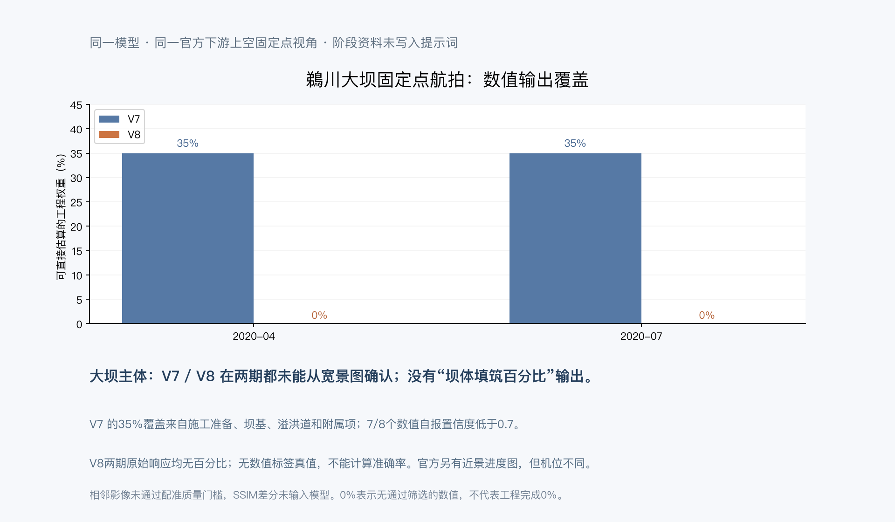

# 鵜川大坝固定点航拍 V7 / V8 实测

**在这组固定点宽景上，V8 两期都没有百分比输出；V7 每期只覆盖 35% 的加权分项。两版都没能确认大坝主体填筑的进展，因此这组照片没有证明 V8 提高了工程主体识别能力。** 没有核实的百分比真值，不能计算数值准确率。

## 数据与公平性

新潟县在 2020 年 4 月和 7 月的施工月报中都把坝址总览图列入“定点写真”栏。标题分别是“下流上空よりダムサイトを望む”和“下流側上空からダムサイトを望む”，都是从下游上空看向坝址。图像尺寸为 640×360 和 640×479，因此它们属于同一固定点观察序列，但不是完全相同的像素构图。

- [2020年4月新潟县月报](https://www.pref.niigata.lg.jp/site/kashiwazaki-seibi/r-2-4kouzinoyousu.html)：称河床部已撤除冬季保护层，接下来开始本格填筑；月报后文称主体填筑正在进行。
- [2020年7月新潟县月报](https://www.pref.niigata.lg.jp/site/kashiwazaki-seibi/r-2-7kouzinoyousu.html)：列出堤体河床部填筑进度照片，以及截至7月31日的断面图。

两版使用相同 `deepseek-v4-flash` 模型、工程名称、坝型和通用识别要求，各按 2020-04、2020-07 顺序运行一次。**模型提示没有包含上述月份施工事实或进度标签**；提示只注明工程、坝型和一般范围限制。实际模型仍可能从训练数据中记得工程公开资料，不能称为严格的视觉盲测。相邻照片的 CV 配准没有通过质量门槛，因此两版都只看原图，没有收到差分图。

## 结果

| 指标 | V7 | V8 |
|---|---:|---:|
| 日期 × 分项槽位 | 16 | 16 |
| 本期直接数值估算 | 8（50%） | 0（0%） |
| 平均本期估算权重覆盖 | 35% | 0% |
| 2020-04 坝体填筑判断 | 无法确认，无数值 | 无法确认，无数值 |
| 2020-07 坝体填筑判断 | 无法确认，无数值 | 无法确认，无数值 |
| 全工程单值 | 两期均无 | 两期均无 |

V7 每期给施工准备、坝基、溢洪道和附属工程四项数值。八个数值中有七个自报置信度低于 V8 使用的 0.7 筛选值；自报置信度不是校准正确率。V7 原始响应也认为大坝填筑主体在这张宽景里看不清。V8 同样拒绝给坝体百分比，另外不输出其他分项百分比。

## 对固定机位的实际结论

虽然官方月报文字确认 4 月开始本格填筑、7 月仍有堤体填筑活动，但两版都无法从固定点总览图辨认坝体填筑状态。模型指出河床大面积开挖面和泄槽明显，堆石填筑断面与坝体轮廓在远景中不清楚。这说明当前固定点画面适合记录整体施工场地与泄槽等显著结构变化，**不足以验证主坝填筑进度**。

新潟县月报还提供“左岸から堤体河床部を望む”的近景进度图，但 4 月图是带 A-A 标记的 640×480 近景，7 月图是 1200×545 宽幅全景，构图和视角明显不同。本次没有把它们混进固定点测试。若要识别主体填筑，下一组样本应选择同一近景固定机位的连续照片，并确保填筑作业面在画面里占有足够像素。

这些官方记录只支持“填筑活动正在推进”的阶段判断，没有提供本任务所需的本期影像分项百分比标签；因此不计算 MAE、RMSE、区间命中率或真实准确率。不能将 V7 的百分比当作真值，也不能把 V8 的拒答称为准确率提高。

**运行记录更正：**第一次试跑的上下文意外含有 4 月与 7 月施工事实，会把标签泄漏给模型；其输出已从本报告和统计中排除。正式结果来自第二次运行，使用去除日期施工事实后的上下文及两个新的输出目录。代码和输入散列见 [结果 JSON](live_comparison_results.json)，可复跑脚本见 [运行脚本](run_live_comparison.py)。完整线上历史位于 `output/ukawa_fixed_blind_live_v7_20261126/` 和 `output/ukawa_fixed_blind_live_v8_20261126/`。

## V9 固定镜头时序识别

使用同一组官方定点照片，以中性工程背景实际调用 `deepseek-v4-flash` 两次，并跳过不合格的 CV 配准差分输入。首期 2020-04 没有时序事件；第二期 2020-07 的原始响应提出三条候选：坝体填筑面扩大、右侧混凝土槽局部延伸、临时设施增加。两期的工程百分比覆盖率均为 0%，总进度保持未知。

将同一模型响应离线重放到新增筛选规则后，坝体和混凝土槽两条施工变化保留；临时设施增加因被错误标为 `advanced` 而拒绝。阶段证据也从模型响应中的自然语言 `observation` 字段恢复，状态可显示为准备、坝基、坝体、溢洪道和附属工程“施工中”，导流、取放水和机电项“无法判断”。这说明修正后的解析和过滤环节正确保留文字证据并拦截方向冲突。

官方月报文字支持这段时期坝体填筑活动正在推进，但没有提供三条事件的逐条图像标注、证据框真值或完成率标签。因此本次没有可计算的事件精确率、召回率、框重叠率、MAE 或准确率提升结论。V9输出的是可复核变化记录，不能与 V7/V8 百分比指标作数值精度对比。

可复查文件：[实际模型响应结果](live_temporal_results.json)、[修正规则离线重放](live_temporal_replay_results.json)、[真实调用脚本](run_live_temporal.py)、[重放脚本](replay_live_temporal.py)、[两期照片并排图](fixed_view_pair.png)。对应历史输出在项目根目录的 `output/ukawa_fixed_temporal_live_20261126/` 与 `output/ukawa_fixed_temporal_replay_20261126/`。
